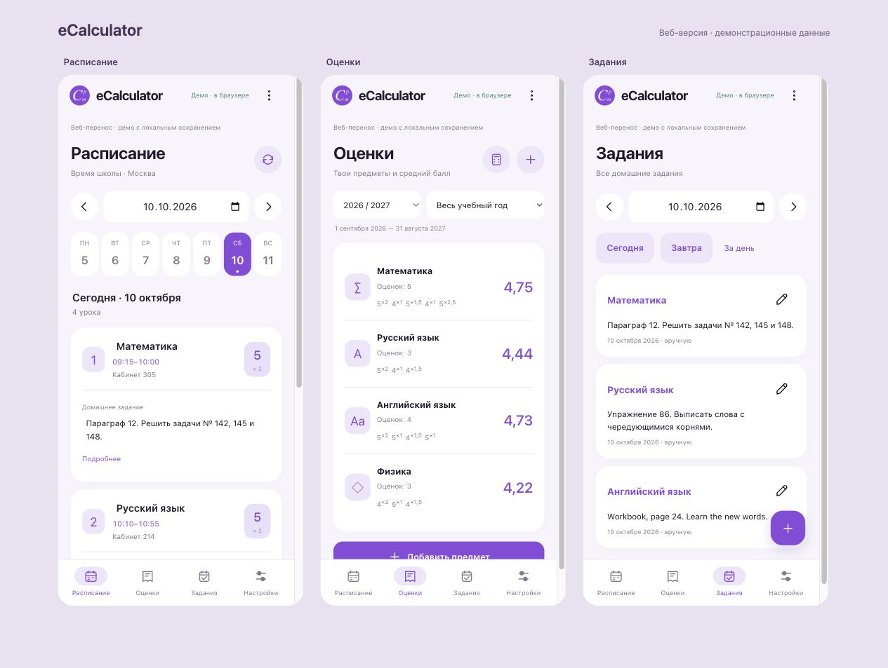

# eCalculator Web

Личный школьный дневник и калькулятор среднего балла на Google Apps Script. Интерфейс адаптирован под телефон и компьютер, данные сохраняются в Google Таблице владельца.

**Android-оригинал:** [d1amp0](https://t.me/d1amp0). **Соавтор веб-версии:** [podlink5](https://t.me/podlink5) · [GitHub](https://github.com/kirya2882).

## Возможности

- Расписание по дням: время уроков, кабинеты, оценки и домашние задания.
- Предметы, оценки от 1 до 5, коэффициенты и настраиваемый учёт знаков +/−.
- Калькулятор с отдельными сценариями: можно проверить будущую оценку, не меняя журнал.
- Задания и скачивание вложений eSchool.
- Запоминание входа eSchool и обновление данных, пока приложение открыто.
- Светлая, тёмная и системная темы; определение часового пояса по настройкам устройства.

Средний балл: **Σ(оценка × коэффициент) / Σ(коэффициентов)**. Быстрые коэффициенты: **0,5 · 1 · 1,25 · 1,35 · 1,5 · 1,75 · 2 · 2,5**.

## Запуск

[Пошаговая установка в Google Apps Script](docs/SETUP.md).

GitHub хранит исходники и картинку логотипа. Рабочее приложение запускается по личной ссылке Google Apps Script с окончанием `/exec`. GitHub Pages для этого проекта включать не требуется.

## Файлы проекта

| Файл | Назначение |
| --- | --- |
| `Code.gs` | Запуск приложения и журнал Google Таблицы |
| `ESchool.gs` | Вход, чтение данных и файлов eSchool |
| `Extensions.gs` | Обработка заданий, расписания, настроек и импорта |
| `Index.html` | Основной интерфейс |
| `Core.html` | Расчёты и общие функции |
| `Schedule.html` | Экран расписания |
| `ESchoolUI.html` | Подключение и автообновление eSchool |
| `appsscript.json` | Настройки среды и разрешения Google |
| `Icon.png` | Логотип и favicon |
| `docs/` | Инструкции по запуску и использованию |
| `tests/` | Проверки запуска и автообновления на имитации среды Google |

## Данные и доступ

Проект рассчитан на одного владельца. При развёртывании выбирай доступ **«Только у меня»**. Публикация исходников на GitHub не публикует таблицу с оценками или серверные свойства проекта.

Настоящие логин, пароль, cookies, идентификатор личной таблицы и ссылка на личное развёртывание в этот комплект не включены. При использовании вход eSchool сохраняется в приватных свойствах пользователя Apps Script: логин, SHA-256 пароля и cookies. SHA-256 используется сервисом как реквизит входа и тоже должен оставаться закрытым. Кнопка выхода удаляет сохранённые реквизиты.

## Ограничения

Это неофициальная веб-версия, основанная на функциях Android-приложения. Полное совпадение с оригиналом не заявляется; связь с официальными разработчиками eSchool не подразумевается.

Поддерживается вход ученика; CAPTCHA, двухфакторный вход и роли родителя или учителя не реализованы. Изменение API eSchool может потребовать обновления интеграции.

Без сети доступен ранее загруженный кэш; запись и синхронизация требуют интернета. Автообновление не работает после закрытия приложения.

Favicon вкладки подключён. На iPhone собственная иконка при стандартном добавлении ссылки на экран «Домой» **не заработала в проверке владельца**: этому мешает внешняя оболочка Apps Script. Профили установки и дополнительные загрузки для телефона в комплект не входят.

## Проверки для разработки

Если установлен Node.js, открой терминал в папке репозитория и выполни `npm test`. Устанавливать npm-пакеты не нужно. Для обычного запуска через Apps Script Node.js не требуется.

Тесты проверяют запуск, обработку ошибок и логику автообновления с имитацией сервера; они не подтверждают доступность eSchool или работу на физическом iPhone.

## Авторы

Сведения об оригинале и веб-версии: [AUTHORS.md](AUTHORS.md).
